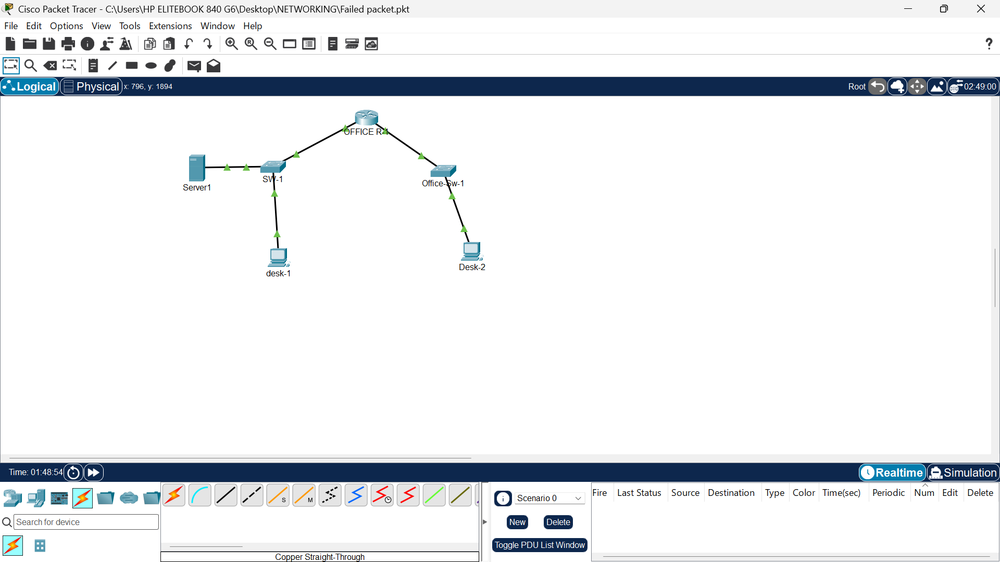

# Bima-Corporate-Branch-Network

A small corporate branch network built in **Cisco Packet Tracer 9.0.1.0858**.

I created this project to practise how devices in an office network connect and communicate—not just to draw a topology, but to configure IP addressing, connect the network devices, and test a service that users might actually need.

## Project overview

The topology represents one branch of a fictional organisation, **Bima Corporate**. A router connects two LAN segments, each served by its own switch. A desktop PC and a server sit on one segment, while a second desktop PC sits on the other.

The goal was to build a simple foundation that can be expanded later with wireless devices, VLANs, stronger access controls, and additional branches.

## Topology

**Devices in this build**
- 1 router — `OFFICE R-1`
- 2 switches — `SW-1` and `Office-Sw-1`
- 2 desktop PCs — `desk-1` and `Desk-2`
- 1 server — `Server1`

## IP addressing plan

The two router interfaces act as the default gateways for the two subnets.

| Device | Interface / role | IPv4 address | Subnet mask | Default gateway |
|---|---|---:|---:|---:|
| Router | `GigabitEthernet0/0/0` — LAN 1 gateway | `192.168.1.1` | `255.255.255.0` | — |
| Router | `GigabitEthernet0/0/1` — LAN 2 gateway | `192.168.2.1` | `255.255.255.0` | — |
| `desk-1` | `FastEthernet0` | `192.168.1.10` | `255.255.255.0` | `192.168.1.1` |
| `Server1` | Network interface | `192.168.1.18` | `255.255.255.0` | `192.168.1.1` |
| `Desk-2` | `FastEthernet0` | `192.168.2.19` | `255.255.255.0` | `192.168.2.1` |

> These are the addresses visible in the project screenshots. The two `/24` networks are different subnets, so traffic between them must pass through the router.

## What I configured and tested

- Connected the router, switches, desktop PCs, and server with wired Ethernet links.
- Assigned static IPv4 addresses to the end devices.
- Configured two router interfaces as gateways for `192.168.1.0/24` and `192.168.2.0/24`.
- Checked the router's interface status and routing table with `show ip interface brief` and `show ip route`.
- Configured and tested email communication using the Packet Tracer server and desktop email client.
- Used Simulation mode to inspect packet events and learn how frames and packets move through the topology.

### Evidence from the build

**Router interfaces and routing table**

The router output shows both LAN interfaces as `up/up` and both connected networks in the routing table. This confirms the router knows those two directly connected networks. It does not, by itself, prove every end-to-end service works.

**Desktop IP configuration**

**Server IP configuration**

**Email test**

The screenshots document a successful email send/receive test in Packet Tracer. This is a useful application-level test, beyond simply checking whether cables are connected.

## Lessons learned

This project helped me practise the relationship between:
- **IP addresses and subnets:** devices need addresses that fit their local network.
- **Default gateways:** a device uses its gateway when the destination is outside its own subnet.
- **Switches and routers:** switches connect devices within a LAN; routers move traffic between different IP networks.
- **Services and connectivity:** a working link is only one part of the picture. IP settings and application configuration also matter.
- **Simulation mode:** packet events can help locate where communication succeeds or fails.

## Current scope and next steps

This is a learning project, not a finished production network. The current build uses static addressing and has not yet demonstrated a complete security baseline.

Planned improvements:
1. Verify end-to-end connectivity between all intended devices with ICMP tests.
2. Document the email server's service settings and client configuration.
3. Add secure device administration (console/VTY access and strong credentials).
4. Disable unused switch ports and consider port security.
5. Introduce separate VLANs for staff, guests, and servers, with appropriate access controls.
6. Add a wireless network for office laptops and phones.
7. Expand the design to multiple branches and a headquarters, with routing between sites.

## Project file

The Cisco Packet Tracer `.pkt` file contains the simulated network. Open it with a compatible version of Packet Tracer to inspect the devices and configuration.

## Tools

- Cisco Packet Tracer `9.0.1.0858`
- IPv4 addressing and subnetting
- Basic router and switch configuration
- Packet Tracer server and email simulation

---

**Project status:** Learning project in progress  
**Organisation:** Bima Corporate (fictional)  

